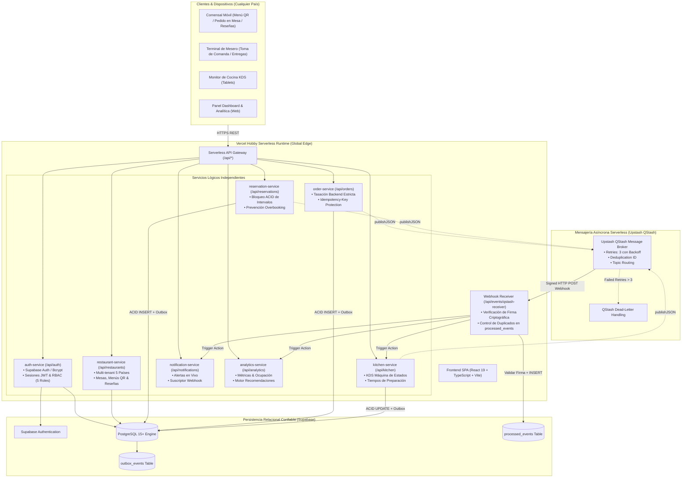
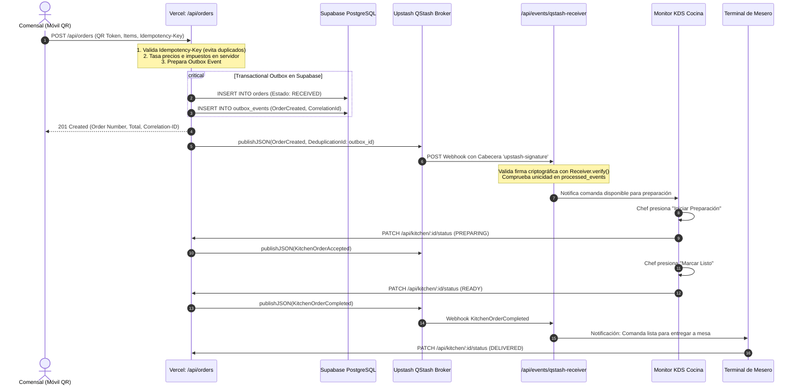

# Arquitectura Serverless Distribuida — SmartRestaurant
## Vercel Hobby + Supabase (PostgreSQL + Auth) + Upstash QStash

---

## 1. Topología del Sistema Serverless

SmartRestaurant opera como un **sistema distribuido serverless** compuesto por funciones lógicas desacopladas alojadas en la infraestructura global de Vercel, respaldado por una base de datos relacional PostgreSQL con Row Level Security (RLS) en Supabase, y coordinado asíncronamente mediante el broker serverless Upstash QStash con verificación de firmas criptográficas.

---

## 2. Diagrama de Secuencia: Ciclo de Comanda con Transactional Outbox y QStash

---

## 3. Matriz de Servicios Lógicos y Rutas API

| Servicio Lógico | Ruta Base Vercel | Responsabilidades | Eventos Emitidos a QStash |
|---|---|---|---|
| **Auth Service** | `/api/auth` | Registro, login, recuperación de contraseña, JWT, RBAC (5 roles). | - |
| **Restaurant Service** | `/api/restaurants` | Sedes (5 países), mesas, menús QR, disponibilidad y reseñas. | - |
| **Reservation Service** | `/api/reservations` | Bloqueo ACID de intervalos, prevención 409 Conflict. | `ReservationCreated`, `ReservationCancelled` |
| **Order Service** | `/api/orders` | Idempotencia, cálculo seguro de precios y tasas locales. | `OrderCreated`, `OrderUpdated` |
| **Kitchen Service** | `/api/kitchen` | Fila KDS, máquina de estados finita y cronómetro. | `KitchenOrderAccepted`, `KitchenOrderCompleted` |
| **Notification Service** | `/api/notifications` | Despacho de notificaciones in-app y alertas operativas. | `NotificationRequested` |
| **Analytics Service** | `/api/analytics` | KPIs de ocupación, ticket promedio y recomendaciones. | - |
| **QStash Receiver** | `/api/events/qstash-receiver` | Verificación de firma criptográfica y enrutamiento idempotente. | - |

---

## 4. Seguridad, Autenticación y RLS

1. **Supabase Auth & Roles:**
   - Contraseñas almacenadas exclusivamente como hashes Bcrypt (costo 10).
   - Tokens JWT firmados con claims de rol (`role`) y tenant (`tenantId`).
   - Los roles permitidos son: `OWNER`, `ADMIN`, `WAITER`, `KITCHEN` y `CUSTOMER`.
   - Se prohíbe confiar en cabeceras de rol enviadas libremente por el cliente (`x-user-role` no tiene validez sin token Bearer verificado).

2. **Aislamiento Multi-Tenant Estricto:**
   - Ninguna consulta permite cruce entre tenants diferentes (`rest-col-01` jamás accede a datos de `rest-mex-02`).
   - El middleware `requireTenantIsolation` rechaza con `403 Forbidden` cualquier intento de acceso cruzado no autorizado.

3. **Verificación de Firmas de QStash:**
   - La función `/api/events/qstash-receiver` valida que cada petición entrante provenga auténticamente de los servidores de Upstash utilizando `@upstash/qstash` `Receiver.verify({ signature, body })`.
   - Si la firma es inválida o expirada, se rechaza inmediatamente con `401 Unauthorized`.
   - La tabla `processed_events` garantiza que los reintentos automáticos de QStash no dupliquen mutaciones de negocio.

4. **Variables de Entorno y Secretos:**
   - `SUPABASE_SERVICE_ROLE_KEY` se utiliza **únicamente** en funciones serverless backend de Vercel. Nunca se expone al cliente ni a variables `VITE_` o `NEXT_PUBLIC_`.
