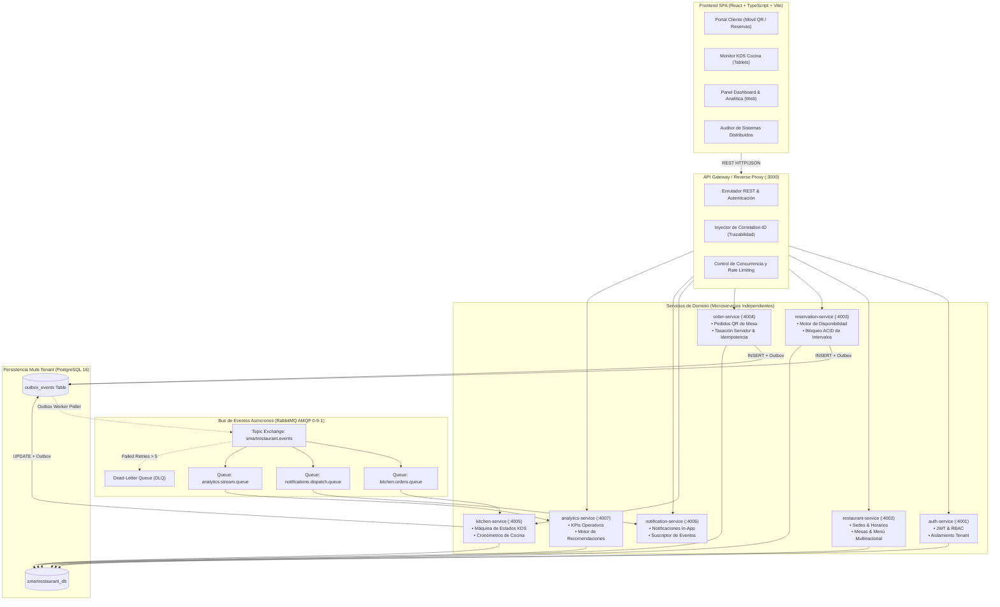
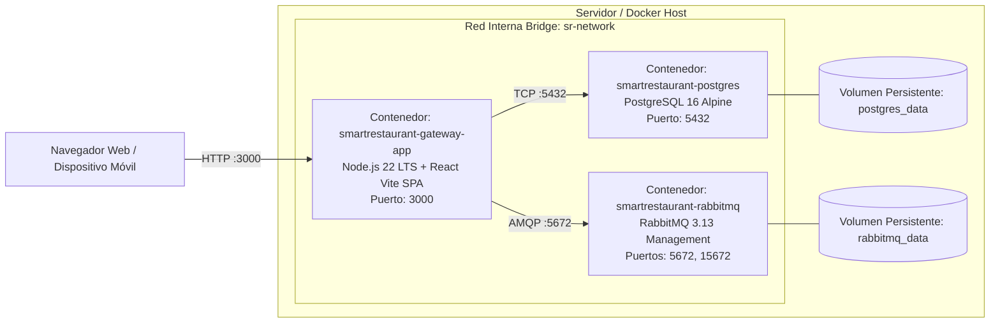

# Arquitectura del Sistema Distribuido — SmartRestaurant

**Nombre Académico:** Plataforma Distribuida Multinacional para la Gestión Inteligente de Reservas y Pedidos en Restaurantes.

---

## 1. Diagrama de Componentes (Mermaid)

El siguiente diagrama detalla la arquitectura de microservicios, la puerta de enlace (API Gateway), el broker de mensajería asíncrona RabbitMQ y el motor de persistencia multi-tenant PostgreSQL:

---

## 2. Diagrama de Despliegue en Infraestructura (Docker Compose)

---

## 3. Matriz de Responsabilidades de los Microservicios

| Microservicio | Puerto | Entidades Propietarias | Eventos Publicados | Eventos Consumidos |
|---|---|---|---|---|
| **auth-service** | 4001 | Usuarios, Roles, Permisos, Tokens JWT | `UserRegistered` | - |
| **restaurant-service** | 4002 | Restaurantes (Tenants), Sucursales, Mesas, Menús, Platos | `MenuPriceUpdated`, `BranchConfigured` | - |
| **reservation-service** | 4003 | Reservas, Disponibilidad de Mesas | `ReservationCreated`, `ReservationCancelled` | - |
| **order-service** | 4004 | Pedidos (Orders), Ítems de Pedido, Idempotencia | `OrderCreated`, `OrderConfirmed` | `OrderStatusChanged` |
| **kitchen-service** | 4005 | Comandas KDS, Fila de Preparación, Tiempos | `OrderAcceptedByKitchen`, `OrderStatusChanged`, `OrderReady`, `OrderDelivered` | `OrderCreated` |
| **notification-service**| 4006 | Notificaciones In-App, Despacho Email/SMS | - | `ReservationCreated`, `OrderCreated`, `OrderReady` |
| **analytics-service** | 4007 | Agregaciones, Informes de Ocupación, Recomendaciones | `RecommendationGenerated` | `*` (Todos los eventos de negocio) |
