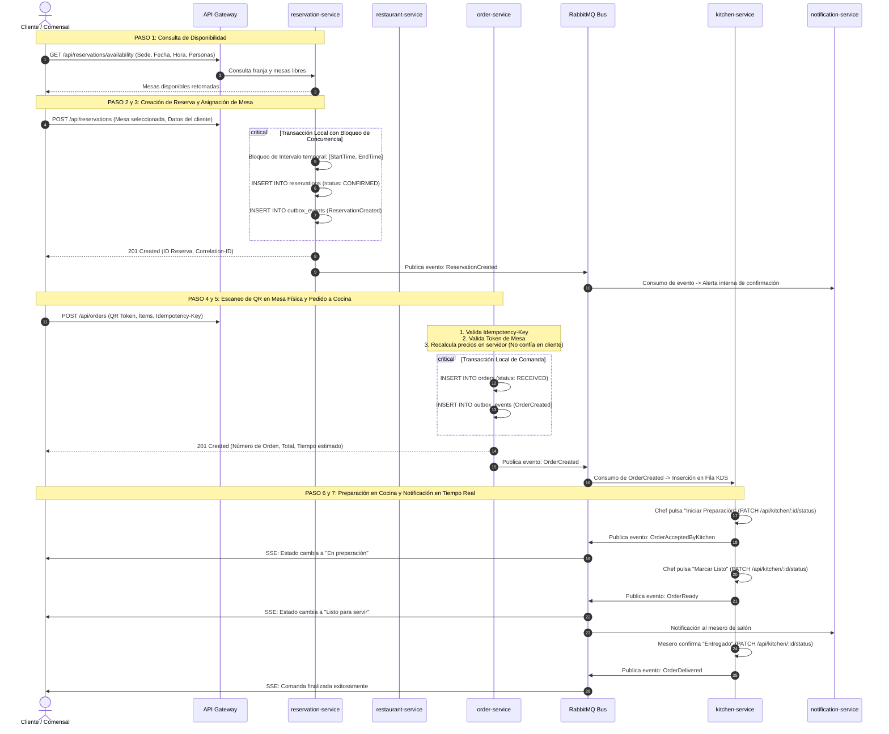

# Transacción Principal del Negocio — SmartRestaurant

## Definición Canónica de la Transacción

> **«Conectar a un cliente que necesita una experiencia gastronómica con un restaurante que dispone de capacidad para atenderlo, coordinando su reserva, pedido y servicio en tiempo real».**

---

## 1. Naturaleza Distribuida (Core Distributed Workflow)

En una arquitectura de microservicios, esta transacción **NO es una única transacción ACID monolítica** de base de datos que abarque todos los servicios. Un bloqueo global de dos fases (2PC / Two-Phase Commit) generaría alta latencia y acoplamiento severo entre servicios.

En su lugar, SmartRestaurant implementa una **transacción distribuida por orquestación basada en eventos y consistencia eventual (Eventual Consistency)**, compuesta por transacciones locales atómicas en cada servicio y eventos asíncronos transportados a través de RabbitMQ mediante el patrón **Transactional Outbox**.

---

## 2. Etapas Detalladas de la Transacción

---

## 3. Garantías de Consistencia y Tolerancia a Fallos

1. **Garantía Inmediata (Strong Consistency):**
   - El bloqueo de mesas para una misma franja horaria es inmediatamente consistente dentro del `reservation-service` gracias a la validación atómica en PostgreSQL.
   - El cálculo de totales de platos e impuestos se verifica inmediatamente en el `order-service` antes de persistir la comanda.
2. **Garantía Eventual (Eventual Consistency):**
   - La llegada de la comanda a la pantalla del cocinero (KDS) y la actualización de métricas en el `analytics-service` se propagan de manera asíncrona a través de RabbitMQ. Si el broker experimenta una micro-desconexión, los mensajes no se pierden gracias a la tabla local `outbox_events` y son reintentados automáticamente.
3. **Idempotencia:**
   - La cabecera `Idempotency-Key` en los pedidos y la deduplicación por `event_id` en los consumidores aseguran que ningún cobro ni comanda se dupliquen por reintentos de red.
